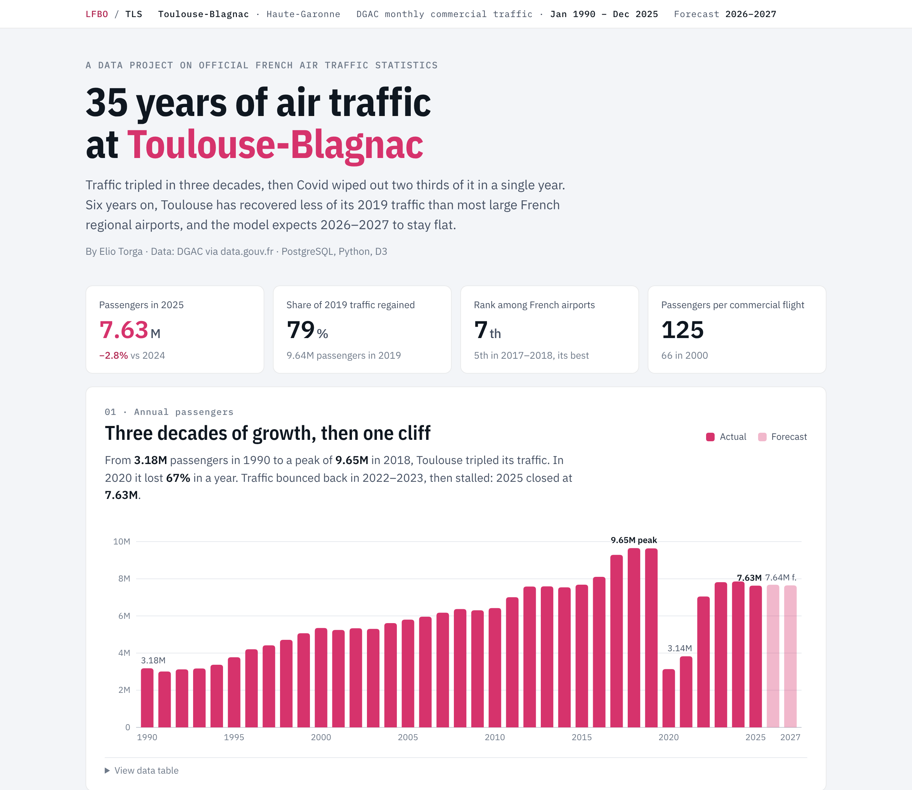
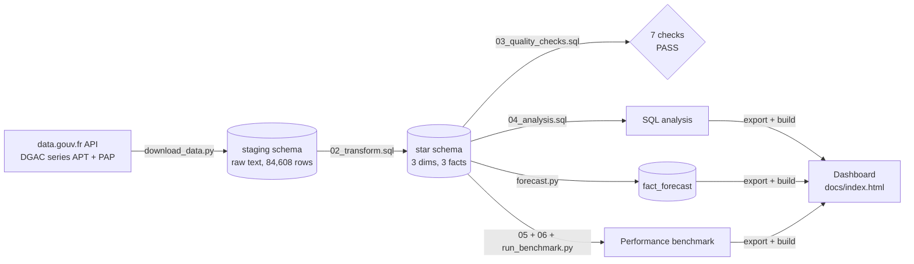
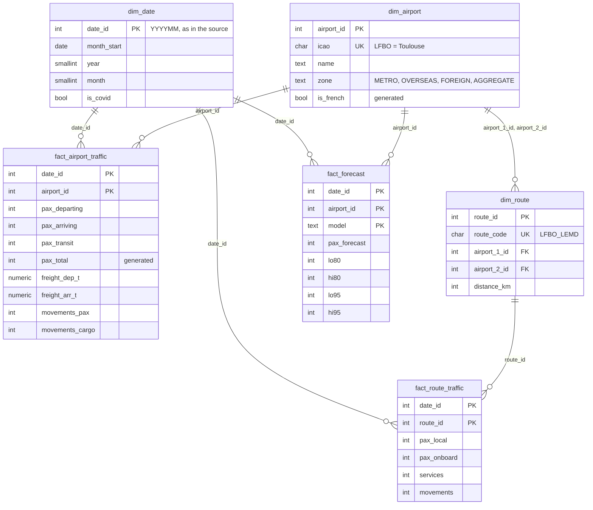
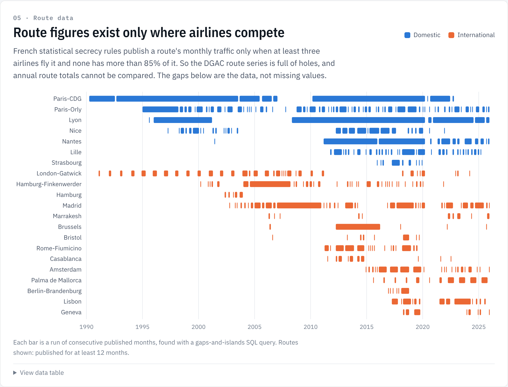
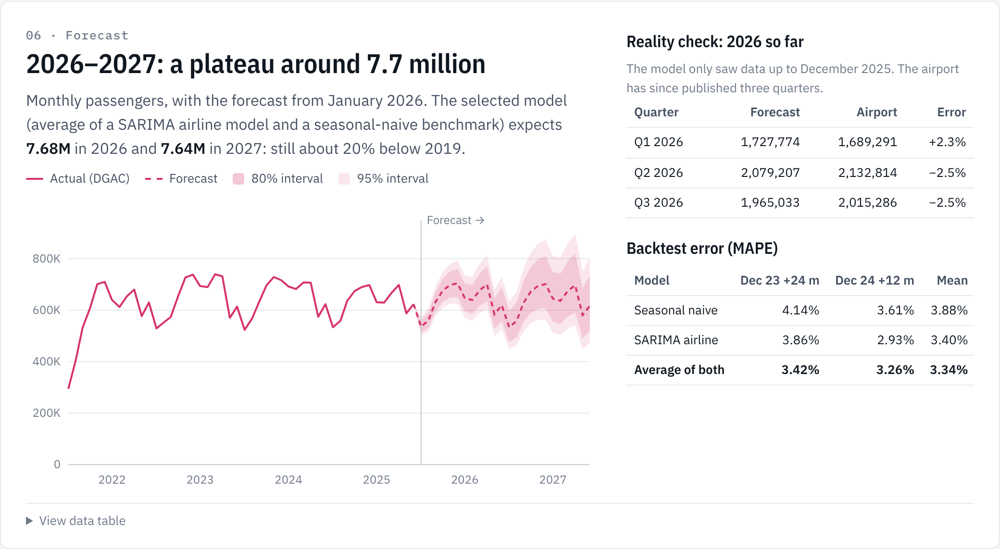

# 35 years of air traffic at Toulouse-Blagnac

**An end-to-end data project on official French air traffic statistics: data modelling in PostgreSQL, advanced SQL, query performance tuning and a validated forecast, delivered as an interactive dashboard.**

   



> I live in Toulouse, Europe's aerospace capital, and I have always been passionate about aviation. I modelled 35 years of official DGAC traffic data to understand how Toulouse-Blagnac grew, how it recovered from Covid compared with other regional airports, and where it is heading.
>
> Elio Torga

**Live dashboard:** open `docs/index.html`, or enable GitHub Pages on the `/docs` folder (Settings → Pages → Deploy from branch → `main` / `docs`).

---

## Key findings

| | Finding | Evidence |
|---|---|---|
| 1 | **Traffic tripled, then fell by two thirds in one year.** 3.18 M passengers in 1990, a 9.65 M peak in 2018, 3.14 M in 2020. | `fact_airport_traffic` |
| 2 | **Toulouse recovered less than most of its peers.** 2025 traffic is 79.2 % of 2019; among the 10 largest regional airports only Lille (77.9 %) and Bordeaux (76.3 %) did worse. Marseille, Nice and Basel-Mulhouse are above their 2019 level. | Q2 |
| 3 | **The Paris shuttle collapsed.** Toulouse–Paris-Orly carried 45 % fewer passengers in 2025 than in 2019, on the same calendar months. The airport reports domestic traffic at 65 % of its 2019 level in Q2 2026, against 101 % for international. | Q6, [airport, Q2 2026](https://www.toulouse.aeroport.fr/sites/default/files/2026-08/CP_Trafic_T2_2026.pdf) |
| 4 | **A business airport became a leisure one.** August was the quietest month of the 1990s (7.0 % of yearly traffic); it carries 8.6 % in the 2020s. January fell from 7.9 % to 6.2 %. | Q3 |
| 5 | **Planes got bigger and fuller.** Passengers per commercial flight went from 66 (1999) to 125 (2025): 60,957 flights carried 7.6 M passengers in 2025, against 81,340 flights for 5.4 M in 2000. | Q1 |
| 6 | **2026–2027 should stay flat**, around 7.7 M passengers a year, still about 20 % below 2019. The forecast was within 2.6 % of each of the three 2026 quarters published since. | `forecast.py` |

Toulouse also slipped from 5th French airport (2017–2018) to 7th (2023–2025).

---

## What this project demonstrates

| Skill | Where |
|---|---|
| **Data modelling**: star schema, surrogate keys, generated columns, constraints, a documented grain per fact table | [`sql/01_schema.sql`](sql/01_schema.sql) |
| **ELT and data quality**: raw CSV kept untouched in a staging schema, typed in SQL, 7 automated checks (row reconciliation, completeness, an internal accounting identity, an external benchmark) | [`python/load_staging.py`](python/load_staging.py), [`sql/02_transform.sql`](sql/02_transform.sql), [`sql/03_quality_checks.sql`](sql/03_quality_checks.sql) |
| **Advanced SQL**: CTEs, `RANK`, `LAG` with a named `WINDOW`, window frames, `FILTER`, `DISTINCT ON`, gaps-and-islands, like-for-like self-join | [`sql/04_analysis.sql`](sql/04_analysis.sql) |
| **Performance**: `EXPLAIN ANALYZE` benchmark on 17.7 M rows, covering B-tree, BRIN, range partitioning, materialized view | [`sql/06_optimizations.sql`](sql/06_optimizations.sql), [`python/run_benchmark.py`](python/run_benchmark.py) |
| **Forecasting**: SARIMA "airline model" with Covid intervention dummies, two-origin backtest against a naive benchmark, out-of-sample reality check, results written back to the database | [`python/forecast.py`](python/forecast.py) |
| **Data visualisation**: a single self-contained page, light and dark themes, colour-blind-checked palette, tooltips and a table view for every chart | [`dashboard/template.html`](dashboard/template.html) |

---

## Architecture



### Data model



**Grain.** `fact_airport_traffic`: one airport, one month (complete). `fact_route_traffic`: one airport pair, one month (incomplete by design, see below). All totals come from the airport fact table.

---

## Data

Source: DGAC (French civil aviation authority), [*Trafic aérien commercial mensuel français*](https://www.data.gouv.fr/datasets/64808a5811da153f1439914c) on data.gouv.fr, Licence Ouverte 2.0, January 1990 to December 2025.

| Series | Content | Rows |
|---|---|---|
| ASP_APT | Monthly commercial traffic per French airport: passengers (departing, arriving, transit), freight and mail, movements | 38,821 |
| ASP_PAP | Monthly traffic per airport pair | 45,787 |

### Data limitations (and how they are handled)

- **The route series is incomplete by law.** A route-month is published only if at least 3 operators fly it and none has more than 85 % of the traffic. Annual route totals are therefore not comparable. The project never sums routes into totals, shows the publication gaps explicitly (gaps-and-islands), and compares routes only on months published in both years.
- **Negative freight.** 19 source rows (small French Polynesia airfields) carry −0.1 or −0.2 tonnes, rounding artefacts of corrections. They are floored at 0 and counted in the quality report.
- **Aggregated rows.** Airports under 1,000 passengers a month are grouped into two rows (`ZZMT`, `ZZOM`), modelled as zone `AGGREGATE` and excluded from rankings.
- **DGAC vs airport figures.** The DGAC counts 7,630,981 passengers in 2025; the airport reports [7,621,409](https://www.air-journal.fr/?p=273568) (−0.13 %). The 2026 reality check uses the airport's quarterly figures, the only ones available after December 2025.
- **Internal consistency.** Passenger-equivalents = passengers + 10 × freight tonnes holds within rounding on 99.55 % of rows (max gap 15, on aggregated rows).

### Quality checks

```
 n |                    check_name                    |     result      | status
---+--------------------------------------------------+-----------------+--------
 1 | APT rows: staging = fact                         | 38821 / 38821   | PASS
 2 | PAP rows: staging = fact                         | 45787 / 45787   | PASS
 3 | Toulouse: months with data / months expected     | 432 / 432       | PASS
 4 | PEQ = pax + 10 x freight (within 2, rounding)    | 99.55 % of rows | PASS
 5 | Negative freight values in source (floored at 0) | 19 rows         | PASS
 6 | Routes with more than one published distance     | 0               | PASS
 7 | Toulouse 2025 passengers (airport reports 7.6 M) | 7 630 981       | PASS
```

---

## SQL highlights

| Query | Business question | Techniques |
|---|---|---|
| Q1 | Yearly passengers, growth, national rank, passengers per flight | CTE, `RANK() OVER (PARTITION BY year)`, `LAG` with a named `WINDOW` |
| Q2 | Post-Covid recovery of the 10 largest regional airports | conditional aggregation with `FILTER`, ranking on a ratio, explicit `NULL` handling |
| Q3 | Seasonality by decade, busiest month per year | window `SUM` over a partition then re-aggregation, `DISTINCT ON` |
| Q4 | Trend without seasonality | rolling 12-month frame `ROWS BETWEEN 11 PRECEDING AND CURRENT ROW` |
| Q5 | When was each Toulouse route published? | **gaps and islands** with the `ROW_NUMBER()` offset trick |
| Q6 | Toulouse–Orly 2025 vs 2019, fairly | self-join on calendar month (like-for-like) |

The gaps-and-islands query, the one that makes the incomplete route series usable:

```sql
WITH islands AS (
    SELECT dest_icao, month_start,
           month_start - (ROW_NUMBER() OVER (PARTITION BY dest_icao ORDER BY month_start)
                          * interval '1 month') AS island_key   -- constant while months are consecutive
    FROM published
)
SELECT dest_icao, MIN(month_start) AS period_start, MAX(month_start) AS period_end, COUNT(*) AS months
FROM islands
GROUP BY dest_icao, island_key;
```



---

## Performance

The real fact tables hold about 40,000 rows, too few for indexes to matter. [`sql/05_performance_setup.sql`](sql/05_performance_setup.sql) therefore **simulates a flight-level table from the real monthly totals**: one row per published commercial movement from 2015 to 2025, a random day in the real month, passengers drawn around the real monthly average (±40 %). That gives 17,654,080 rows (878 MB). It is used only for benchmarking, never for the analysis.

Each optimisation is applied in turn, and three typical dashboard queries are timed (median of 5 runs after a warm-up, `EXPLAIN (ANALYZE, BUFFERS)`, PostgreSQL 16, 2 vCPU):

| Query | No index | Best technique | Best | Speed-up |
|---|---:|---|---:|---:|
| A. Toulouse, daily traffic for one month | 400 ms | B-tree `(airport_id, flight_date) INCLUDE (pax)`, index-only scan | 0.80 ms | **×500** |
| B. Top 10 airports for one year | 553 ms | materialized view by airport and month | 0.67 ms | **×825** |
| C. Toulouse, monthly trend over 11 years | 528 ms | materialized view by airport and month | 0.06 ms | **×9,432** |

What the intermediate stages show:

- The **B-tree** turns A into an index-only scan but does nothing for B (a full year of every airport is still about 9 % of the table: sequential scan).
- A **BRIN** index on the date, only **104 KB** against **531 MB** for the B-tree, cuts B from 553 ms to 186 ms because rows are stored in time order.
- **Yearly range partitioning** gets the same result through partition pruning (195 ms), with no index at all for B.
- The **materialized view** (17.7 M rows → about 11,000) is the right tool for dashboards: under a millisecond, refreshed when new data arrives.

Your numbers will differ: run `python python/run_benchmark.py` to measure on your machine (results in `results/benchmark.json` and `results/benchmark.md`).

---

## Forecast

**Model.** SARIMA(0,1,1)(0,1,1)₁₂, the classic "airline model" from Box and Jenkins, fitted on log passengers since 2014, with **one impulse dummy per Covid month** (March 2020 to June 2022). Each crisis month gets its own coefficient, so the crisis does not inflate the residual variance and the prediction intervals stay realistic. The model is compared with a **seasonal-naive** benchmark (last year repeated) and with the **average of both**.

**Backtest** (mean absolute percentage error, two forecast origins):

| Model | Dec 2023 → 24 months | Dec 2024 → 12 months | Mean |
|---|---:|---:|---:|
| Seasonal naive (benchmark) | 4.14 % | 3.61 % | 3.88 % |
| SARIMA airline model | 3.86 % | 2.93 % | 3.40 % |
| **Average of both (selected)** | **3.42 %** | **3.26 %** | **3.34 %** |

A first version with two broad Covid dummies did *worse* than the naive benchmark (MAPE 5–15 % depending on the orders): the crisis months inflated the error variance, the fit leaned on pre-2020 growth and over-forecast a market that has been flat since 2023, with 80 % intervals more than 100 % wide. Testing against a naive benchmark is what caught it.

**Reality check.** The model only saw data up to December 2025. The airport has since published three quarters of 2026:

| Quarter | Forecast | Airport reported | Error |
|---|---:|---:|---:|
| Q1 2026 | 1,727,774 | [1,689,291](https://www.air-journal.fr/?p=275367) | +2.3 % |
| Q2 2026 | 2,079,207 | [2,132,814](https://www.toulouse.aeroport.fr/sites/default/files/2026-08/CP_Trafic_T2_2026.pdf) | −2.5 % |
| Q3 2026 | 1,965,033 | [2,015,286](https://www.air-journal.fr/?p=278869) | −2.5 % |

**Forecast:** 7.68 M passengers in 2026 and 7.64 M in 2027 (monthly 80 % and 95 % intervals in `fact_forecast`).



---

## How to run

Requirements: Docker (or a local PostgreSQL 16) and Python 3.11+.

```bash
git clone <this repo> && cd toulouse-airport-traffic
docker compose up -d                      # PostgreSQL 16 on localhost:5432
python -m venv .venv && source .venv/bin/activate
pip install -r requirements.txt
./run_all.sh                              # about 2 minutes end to end
open docs/index.html                      # the dashboard
```

`run_all.sh` downloads the data, loads staging, builds the star schema, runs the quality checks and analyses, fits the forecast, runs the benchmark and builds the dashboard. Set `DATABASE_URL` to use another database; `SKIP_DOWNLOAD=1 ./run_all.sh` reuses `data/raw`.

## Project structure

```
toulouse-airport-traffic/
├── README.md
├── run_all.sh                    one command, whole pipeline
├── docker-compose.yml            PostgreSQL 16
├── requirements.txt
├── data/README.md                source description (raw files are git-ignored)
├── sql/
│   ├── 01_schema.sql             star schema
│   ├── 02_transform.sql          staging -> typed facts and dimensions
│   ├── 03_quality_checks.sql     7 checks, PASS / WARN
│   ├── 04_analysis.sql           Q1-Q6
│   ├── 05_performance_setup.sql  17.7 M-row simulated flight table
│   └── 06_optimizations.sql      B-tree, BRIN, partitioning, materialized view + benchmark queries
├── python/
│   ├── download_data.py          data.gouv.fr API -> data/raw
│   ├── load_staging.py           CSV -> staging (COPY)
│   ├── forecast.py               backtest, forecast, reality check -> fact_forecast
│   ├── run_benchmark.py          EXPLAIN ANALYZE timings -> results/
│   ├── export_dashboard_data.py  SQL -> dashboard/data.json
│   └── build_dashboard.py        template + data -> docs/index.html
├── dashboard/                    template.html, data.json, index.html
├── docs/                         index.html (GitHub Pages) and screenshots
└── results/                      quality checks, analysis output, forecast metrics, benchmark
```

## Sources

- DGAC, [Trafic aérien commercial mensuel français](https://www.data.gouv.fr/datasets/64808a5811da153f1439914c), series APT and PAP, with their official field notices.
- Aéroport Toulouse-Blagnac, [Q2 2026 traffic press release](https://www.toulouse.aeroport.fr/sites/default/files/2026-08/CP_Trafic_T2_2026.pdf): 2026 quarter and domestic/international split.
- Air Journal, [Q1 2026](https://www.air-journal.fr/?p=275367), [Q3 2026](https://www.air-journal.fr/?p=278869) and [2025 results](https://www.air-journal.fr/?p=273568) (airport figures), [Q1 2025](https://www.air-journal.fr/?p=262563) (easyJet base closure on 31 March 2025).
- Aéroport Toulouse-Blagnac, [2025 annual report](https://www.toulouse.aeroport.fr/sites/default/files/2026-07/ATB-RAPPORT-ANNUEL-2025.pdf): low-cost carriers at 50 % of 2025 traffic.

Code: MIT licence. Data: Licence Ouverte 2.0 (Etalab).
